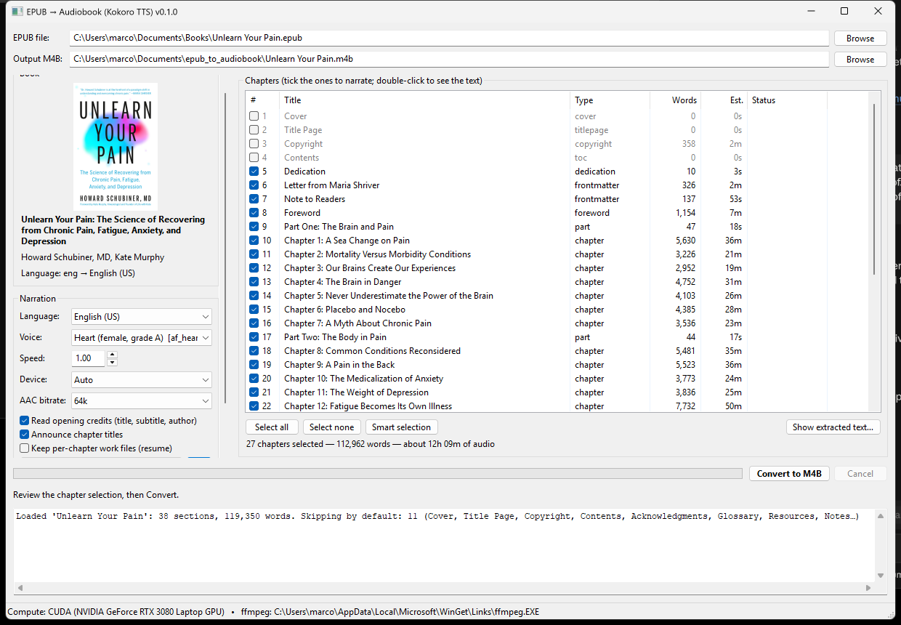

# epub2audiobook — EPUB → M4B audiobook with Kokoro TTS

Turn any EPUB e-book into a chaptered **M4B audiobook** (AAC, cover art, metadata) narrated by the
free, high-quality [Kokoro-82M](https://huggingface.co/hexgrad/Kokoro-82M) neural voices. Runs fully
offline on your own PC. wxPython GUI plus a command-line interface.

**Narration languages:** English (US/UK), Spanish, French, Italian, Portuguese (BR), Hindi, Japanese,
Mandarin Chinese — 54 voices. The language is detected from the book.



**Hear it** — the opening credits and the first lines of a chapter, exactly as the app produces
them (English, voice `af_heart`, default settings; short excerpt from *Unlearn Your Pain* by
Howard Schubiner, used for demonstration only). Also available as
[MP3](docs/sample_en_af_heart.mp3) / [MP4](docs/sample_en_af_heart.mp4).

https://github.com/user-attachments/assets/d7159dc1-c76a-4f7b-99f8-bb99cad2c0a2

## Features

- **Smart text extraction.** Reads the EPUB in reading order and skips what a human narrator would
  skip: cover, title and copyright pages, table of contents, index, glossary, bibliography, endnotes,
  "also by" and ad pages, and Project Gutenberg's header and licence. Inside the text it strips
  footnote/endnote markers, page numbers, page-break anchors, figures, captions and repeated running
  headers. Every section is listed with its
  detected type so you can tick or untick anything, and double-click to see exactly what will be read.
- **Speech-friendly text** (on by default; a checkbox in the GUI, `--no-speech-friendly` on the
  command line). Roman numerals that are surely numbers are read as numbers: chapter and part labels
  ("Chapter V", "Act I, Scene V"), numerals the publisher tagged (Standard Ebooks), Bible references
  ("Luke xiii. 3" as 13:3) and list labels ("(ii)"). Markdown leftovers and symbols that voices read
  aloud (`#`, `**`, `* * *`, `====`) are removed. "I" stays the pronoun.
- **Human-like continuity.** One consistent voice, sentence-aware chunking, and controlled pauses
  (short between sentences, longer between paragraphs, headings and scene breaks). Opening credits
  ("Title. Subtitle. Written by …", localized) and chapter titles are read like a professional
  production.
- **Fast.** Runs on NVIDIA GPUs (about 60x realtime on an RTX 3080: a 12-hour book in ~15 minutes)
  or on CPU. Chapters are AAC-encoded in the background while the next one is synthesized; the final
  M4B assembly takes seconds. Finished chapters are cached, so a cancelled run resumes.
- **Proper M4B.** Chapter markers (QuickTime and Nero formats), title/author/year, embedded cover,
  and the Apple "audiobook" atoms (`stik`, `M4B` brand) so Apple Books, BookPlayer and friends treat
  it as a book.
- **Built-in test player** to check chapters, cover, tags and audio on the PC before copying the file
  to your phone.

## Requirements

| | |
|---|---|
| OS | Windows 10/11 (primary target). macOS and Linux work too, see below. |
| Python | **3.10, 3.11 or 3.12** — Kokoro does not support 3.13 yet. The setup script installs a private 3.12 for you. |
| ffmpeg | any recent build (tested with **ffmpeg 8.0**, `winget install Gyan.FFmpeg`) |
| GPU (optional) | NVIDIA with ≥ 4 GB VRAM for CUDA acceleration. Without a GPU it runs on CPU, roughly 3–8x realtime. |
| Disk | ~6 GB for the virtual environment with CUDA PyTorch (~1.5 GB CPU-only), plus ~330 MB for the Kokoro model downloaded on first use |

Tested configuration: Windows 11, Python 3.12.11, PyTorch 2.11.0 (CUDA 12.8), kokoro 0.9.4,
misaki 0.9.4, wxPython 4.3.1, ffmpeg 8.0, RTX 3080 Laptop 16 GB. Exact package versions are in
`requirements-lock.txt`.

## Installation on Windows

1. **Get the code.** Either `git clone https://github.com/vr-marco/epub2audiobook.git`
   or download the ZIP from GitHub and extract it, e.g. to `C:\Users\<you>\epub2audiobook`.

2. **Run the setup script.** Open *PowerShell* in that folder (right-click the folder → "Open in
   Terminal") and run:

   ```powershell
   Set-ExecutionPolicy -Scope Process Bypass -Force
   .\setup.ps1
   ```

   The script:
   - installs [`uv`](https://docs.astral.sh/uv/) via winget if missing (a small tool that manages
     Python versions and packages; nothing else is installed system-wide),
   - downloads a private **Python 3.12** and creates `.venv` inside the project folder,
   - installs **PyTorch with CUDA 12.8** (~2.5 GB) — use `.\setup.ps1 -Cpu` if you have no NVIDIA
     GPU (much smaller download),
   - installs Kokoro, wxPython and the other Python packages (`-Locked` uses the exact tested
     versions from `requirements-lock.txt`),
   - installs **ffmpeg** via winget if it is not on your PATH.

   Expect 5–15 minutes depending on your connection. If winget is not available on your machine,
   install [ffmpeg](https://www.gyan.dev/ffmpeg/builds/) and [uv](https://docs.astral.sh/uv/getting-started/installation/)
   manually and re-run the script.

3. **Launch:** double-click `run_gui.bat`, or drag an `.epub` file onto it. The first preview or
   conversion downloads the Kokoro model (~330 MB) from Hugging Face; after that everything is offline.

### Manual installation (if you prefer not to use the script)

```powershell
uv python install 3.12
uv venv --python 3.12 .venv
uv pip install --python .venv\Scripts\python.exe torch torchaudio --index-url https://download.pytorch.org/whl/cu128
uv pip install --python .venv\Scripts\python.exe -r requirements.txt
winget install --id Gyan.FFmpeg -e
.venv\Scripts\python.exe -m epub2audiobook
```

With a classic Python 3.12 install instead of uv: `py -3.12 -m venv .venv`, then use
`.venv\Scripts\python.exe -m pip install …` with the same package lists.

### macOS / Linux

Same steps with `uv` (or `python3.12 -m venv .venv`), `pip install torch torchaudio` (default
index: CPU on Linux, Metal/CPU on macOS) and ffmpeg from Homebrew/apt. Launch with
`.venv/bin/python -m epub2audiobook`. espeak-ng is bundled by the `espeakng-loader` package, so no
system install is needed.

## Using the GUI

1. **EPUB file** → pick your book. Cover, title, author, detected language and the section list appear.
2. Review the ticked sections. The *Type* column shows why something is skipped by default
   (`toc`, `endnotes`, `index`, …). *Smart selection* restores the defaults. Double-click a section
   (or *Show extracted text…*) to see the exact narration text.
3. Choose **Language** (auto-detected), **Voice** (ordered by quality, letter grades from the Kokoro
   authors; you can also type any voice id), **Speed** and **AAC bitrate**
   (64k is plenty for speech; 128k roughly doubles the file size).
4. **Speech engine.** *Local (Kokoro)* runs on this computer: pick the **Model** (Kokoro v1.0 with 9
   languages, or v1.1-zh for Mandarin and English), the **Device** (Auto uses the GPU when available),
   and optionally the **CPU threads** and a **Max VRAM** cap (0 = defaults). *OpenAI-compatible server*
   sends the text to any server with OpenAI's speech API, such as a local
   [Kokoro-FastAPI](https://github.com/remsky/Kokoro-FastAPI) or a hosted TTS service, several chunks
   at a time (**Parallel**). *OpenRouter* is the same with [OpenRouter](https://openrouter.ai)'s
   settings filled in (Kokoro by default; any of its speech models by **Model name**). Type the
   **API key** (it is shown as dots), or leave it empty to use the environment variable named in
   **Key env var**. Keys are saved in `%USERPROFILE%\.epub2audiobook-keys.json`, which only your account
   can read, never in the settings file. Each server engine remembers its own fields and key.
5. **Preview voice** plays a sample from the selected section.
6. **Convert to M4B.** The status line shows progress and ETA, the *Status* column tracks each
   chapter (synthesizing → encoding → done), and the log shows details. *Cancel* keeps the finished
   chapters so the next run resumes.
7. When finished, **Test in player** opens the M4B in the built-in player. Its *Checks* line confirms
   chapters, cover, tags and the Apple audiobook flag.

Settings (voice per language, speed, bitrate, speech engine, …) are remembered in
`%USERPROFILE%\.epub2audiobook.json`. It never holds an API key, so you can share it safely.

## Getting the M4B onto an iPhone

iOS cannot import an audiobook into Apple Books from the phone itself (Files, AirDrop and iCloud
Drive only *play* the file). Options:

- **Recommended:** the free, open-source [BookPlayer](https://apps.apple.com/us/app/bookplayer/id1138219998)
  app. Put the `.m4b` in iCloud Drive (or drop it into BookPlayer's folder with the Apple Devices app
  → *Files* tab) and import it from Files. Chapters, cover, resume and sleep timer all work.
- **Apple Books via a Mac:** drag the `.m4b` into Books, then Finder → iPhone → *Audiobooks* → Sync.
- **Apple Books via Windows:** only iTunes for Windows can sync audiobooks, and it stops working if
  the Apple Devices / Apple Music / Apple TV apps are installed (the Apple Devices app has no audiobook
  support). Paid tools such as iMazing can push audiobooks into Books instead.

Android: any audiobook player that reads M4B (Smart AudioBook Player, Voice, Listen Audiobook Player).

## Command line

```powershell
.venv\Scripts\python.exe -m epub2audiobook book.epub --list           # show sections & smart selection
.venv\Scripts\python.exe -m epub2audiobook book.epub --dump-text 10   # show extracted text of section 10
.venv\Scripts\python.exe -m epub2audiobook book.epub -o out.m4b       # convert with smart selection
.venv\Scripts\python.exe -m epub2audiobook book.epub -c 8-31 -v af_bella -s 1.05 --bitrate 64k
.venv\Scripts\python.exe -m epub2audiobook --voices book.epub         # list voices per language (of --model)
.venv\Scripts\python.exe -m epub2audiobook --play out.m4b             # open the test player
.venv\Scripts\python.exe -m epub2audiobook --fix-tags old.m4b         # add Apple audiobook atoms to an existing file
.venv\Scripts\python.exe -m epub2audiobook book.epub --model kokoro-v1.1-zh --threads 6 --max-vram 2
.venv\Scripts\python.exe -m epub2audiobook book.epub --provider openai --base-url http://localhost:8880/v1 --concurrency 8
.venv\Scripts\python.exe -m epub2audiobook book.epub --provider openrouter --concurrency 8   # key in OPENROUTER_API_KEY
.venv\Scripts\python.exe -m epub2audiobook book.epub --help
```

With `--provider openai`, the text goes to any server with OpenAI's `POST /v1/audio/speech` API
(`--api-model` names its model, e.g. `kokoro` or `tts-1`). The API key is read from `OPENAI_API_KEY`
(or the variable named by `--api-key-env`), never from the command line. If that variable is not set,
the key saved in the GUI for the same engine is used. `--api-format` picks the
audio the server sends: `wav` (default, lossless) or `mp3`.

`--provider openrouter` uses the same API with OpenRouter's defaults: URL `https://openrouter.ai/api/v1`,
model `hexgrad/kokoro-82m` (about $0.62 per million characters), key in `OPENROUTER_API_KEY`, and `mp3`
(OpenRouter sends no WAV). Every default can be overridden, e.g. `--api-model google/gemini-3.8-flash-tts`;
other models need their own voice names in `-v`. The log shows how many
characters are sent, because paid APIs bill per character. A wrong URL, key, model or voice stops the
run at once instead of producing silence.

## Project layout

| File | Purpose |
|---|---|
| `epub2audiobook/epub_parser.py` | EPUB → chapters/blocks; section classification; note/page-number/header stripping |
| `epub2audiobook/textproc.py` | text normalisation (note markers, typography, roman numerals, speech-friendly rewrites) and sentence-aware chunking |
| `epub2audiobook/tts.py` | speech-engine interface and settings; local Kokoro engine (model, device, CPU threads, VRAM cap, per-language pipelines) |
| `epub2audiobook/tts_openai.py` | engine for OpenAI-compatible TTS servers and OpenRouter (parallel requests, retries, MP3/WAV, resampling) |
| `epub2audiobook/voices.py` | local models and their languages and voices |
| `epub2audiobook/keys.py` | API keys saved by the GUI (own file, owner-only permissions) |
| `epub2audiobook/audio.py` | silence trimming/pauses/levelling, per-chapter AAC encoding, M4B mux with chapters/cover, Apple audiobook tagging |
| `epub2audiobook/converter.py` | orchestration: credits, chapters, overlapped encoding, progress/cancel, per-chapter cache |
| `epub2audiobook/gui.py` | wxPython application |
| `epub2audiobook/player.py` | built-in M4B test player (ffprobe/ffmpeg + sounddevice) |
| `epub2audiobook/cli.py`, `app.py` | command-line interface and entry-point dispatcher |
| `setup.ps1`, `run_gui.bat` | Windows setup and launcher |
| `tests/` | pytest tests for the engines, the converter, the parser and the text rules (`python -m pytest tests`) |

## Troubleshooting

- **"kokoro requires Python <3.13"** — you are using Python 3.13. Use the setup script (it installs
  3.12 privately) or `py -3.12`.
- **"ffmpeg not found"** — install it (`winget install Gyan.FFmpeg`) and open a new terminal so the
  PATH change is picked up; the status bar at the bottom of the GUI shows which ffmpeg is used.
- **CUDA not used** (status bar says "Compute: CPU") — the CPU build of PyTorch is installed. Re-run
  `setup.ps1` without `-Cpu`, or update your NVIDIA driver (CUDA 12.8 needs a driver from 2025 or newer).
- **First conversion is slow to start** — the Kokoro model and the voice files are being downloaded
  from Hugging Face. Set an `HF_TOKEN` environment variable for faster downloads (optional).
- **Mispronounced names/words** — Kokoro uses a dictionary plus espeak-ng fallback. Speed changes do
  not affect pronunciation; a pronunciation dictionary feature is on the roadmap.

## Roadmap / ideas

- Kokoro voice blending (mix two voices into a custom one).
- A second TTS engine for languages Kokoro lacks (German, Russian, Korean, …), e.g. Qwen3-TTS.
- Per-book pronunciation dictionary.
- Batch conversion of several EPUBs.

## Credits & license

MIT License (see `LICENSE`). Built on [Kokoro-82M](https://huggingface.co/hexgrad/Kokoro-82M)
(Apache 2.0) by hexgrad, [misaki](https://github.com/hexgrad/misaki), [espeak-ng](https://github.com/espeak-ng/espeak-ng),
[ffmpeg](https://ffmpeg.org/), [wxPython](https://wxpython.org/), [ebooklib](https://github.com/aerkalov/ebooklib),
[mutagen](https://mutagen.readthedocs.io/) and [sounddevice](https://python-sounddevice.readthedocs.io/).
Only convert books you are allowed to make personal copies of.
